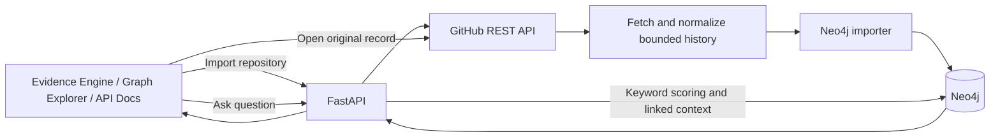

# CodeInsight — Project Guide

**Project title:** Why The Code Is Like This  
**Product name:** CodeInsight  
**Theme:** AI and Developer Tools  
**Purpose:** A practical guide to the prototype’s user flow, architecture, setup, API, and current limitations.

## 1. Overview

CodeInsight is a web prototype for exploring a bounded sample of the history of a public GitHub repository. It imports recent commits, merged pull requests (PRs), and issues into Neo4j. A developer can search those records with a question, inspect matching records and original GitHub links, then view the matching records and their direct graph connections.

The original project idea was to explain why code decisions were made. The current prototype is an evidence finder: it retrieves records using question keywords and displays their sources. It does **not** use an LLM to write an explanation, and a text match or graph relationship does not prove historical intent or causation.

## 2. User flow

1. Open the Evidence Engine and enter a public GitHub URL or `owner/repo`, for example `encode/httpx`.
2. The API validates the repository name and fetches a bounded set of public GitHub records.
3. The importer stores repository entities and relationships in Neo4j.
4. Ask a question using distinctive terms likely to occur in a commit, PR, or issue.
5. Review the evidence cards and open GitHub source links to verify context.
6. Open Graph Explorer in the same browser tab to see the latest search records and their direct connections.

The frontend has three pages:

- **Evidence Engine:** `prototype/frontend/index.html` — imports repositories and searches evidence.
- **Graph Explorer:** `prototype/frontend/graph.html` — displays search matches with directly connected records.
- **Documentation:** `prototype/frontend/docs.html` — interactive reference for the API endpoints.

## 3. Architecture



**Stack and role**

| Layer | Technology | Role |
| --- | --- | --- |
| Frontend | HTML, CSS, vanilla JavaScript | Evidence Engine, graph view, and API reference |
| Backend | Python, FastAPI, Uvicorn | HTTP API, input validation, and import coordination |
| Source data | GitHub REST API | Public repository commits, merged PRs, issues, and selected commit file paths |
| Graph store | Neo4j, Cypher | Stores normalized entities and their relationships |
| Retrieval | Deterministic keyword extraction and weighted matching | Finds records whose stored text overlaps with the question |

The active question endpoint does not call an LLM. Some LLM-related packages remain in `requirements.txt`, but their presence does not mean the current question path uses a model.

## 4. Import behavior and graph model

The import endpoint requests up to **20 commits, 10 merged PRs, and 15 issues**. It also requests detailed changed-file metadata for up to 8 commits and can fetch up to 5 extra issues linked by PR closing text. GitHub may return fewer records. Commits attached to fetched PRs are also imported, so the final commit count can exceed 20; the documented `encode/httpx` run imported 36 commits.

The importer creates these node types:

- `Repository`
- `Commit`
- `PullRequest`
- `Issue`
- `Developer`
- `File`

Relationships include:

| Relationship | Meaning |
| --- | --- |
| `Repository -[:HAS_COMMIT]-> Commit` | The repository contains the commit |
| `Repository -[:HAS_PULL_REQUEST]-> PullRequest` | The repository contains the PR |
| `Repository -[:HAS_ISSUE]-> Issue` | The repository contains the issue |
| `PullRequest -[:INCLUDES_COMMIT]-> Commit` | The PR includes the commit |
| `PullRequest -[:REFERENCES_ISSUE]-> Issue` | The PR references or closes the issue |
| `Commit -[:CHANGED]-> File` | The commit changed the file |
| `Commit -[:AUTHORED_BY]-> Developer` | The developer authored the commit |

Stable IDs preserve repository scope: `owner/repo`, `owner/repo@<commit-sha>`, `owner/repo#<number>`, `github:<login>`, and `owner/repo:<file-path>`.

Imports use Neo4j `MERGE` with these IDs, so repeated imports reuse matching entities and relationships. A later bounded import does not automatically delete older records that were already stored. Neo4j remains the persistent store; the temporary JSON generated during an API import is removed after the request completes.

## 5. Question retrieval and evidence meaning

The retrieval code extracts distinct words from the question, removes common or low-information terms, and scores text on `Commit`, `PullRequest`, and `Issue` nodes:

- A keyword in a title or commit message receives more weight.
- A keyword in summary or description receives a lower weight.
- A keyword in the body receives the least weight.
- The API returns up to 10 direct matches, ordered by score and date.

When one of those direct matches is an issue, the system may add up to 10 PR or commit records connected through `REFERENCES_ISSUE` and `INCLUDES_COMMIT`. The UI labels those records as **linked context**, separately from **direct text matches**. This relationship-based expansion only works when the relevant records and links were imported.

A result means that stored text matched question terms or that a stored graph relationship connects it to a direct match. It is a lead for investigation, not an explanation or proof. Always open the source record and read its surrounding discussion before drawing a conclusion.

## 6. Graph Explorer

Graph Explorer is intended to show the latest Evidence Engine matches plus their direct connections, such as the repository, a related PR, an issue, a commit, a changed file, or an author. It does not show the entire repository history.

The page reads the latest query from the same tab’s browser session storage and the selected repository from local storage. Run the search first, then open Graph Explorer in the same tab. The API may return up to 150 relationships; the visualizer shows at most 60 focused edges and 36 nodes. It groups node types into columns, labels relationship directions with arrows, and lets you click a node to inspect its ID and source link.

A commit can appear in the graph as connected repository history even if it was not a direct text match. Check its graph edge and the evidence card’s match label to understand why it is shown.

## 7. API reference

| Method and path | Purpose |
| --- | --- |
| `GET /` | Confirms the API root responds. |
| `GET /health` | Confirms the FastAPI process responds; it does not check Neo4j. |
| `POST /api/repositories` | Fetches bounded GitHub history and imports it into Neo4j. Body: `{"repository":"owner/repo"}`. |
| `POST /api/ask` | Searches imported records. Body: `{"question":"...","repository":"owner/repo"}`. The repository field is optional; omitting it searches all imported repositories. |
| `GET /api/graph?q=owner%2Frepo&focus=owner%2Frepo%23123` | Retrieves repository graph relationships and prioritizes relationships touching the comma-separated focus record IDs. |

The Documentation page has example requests and interactive controls. Example responses there are illustrative; record counts depend on the repository and GitHub’s API results.

## 8. Run locally

### Requirements

- Python 3.10 or newer
- A reachable Neo4j database and valid credentials
- Network access to GitHub for repository import
- PowerShell commands below assume Windows

### Configure Neo4j

Create `prototype/backend/.env` with your own database credentials:

```dotenv
NEO4J_URI=neo4j+s://your-instance.databases.neo4j.io
NEO4J_USERNAME=neo4j
NEO4J_PASSWORD=your-password
```

The GitHub token is optional for public repositories. If GitHub rate-limits unauthenticated requests, add `GITHUB_TOKEN=your-token` to the same private `.env` file. Never commit that file or share its values. Run the contents of `prototype/backend/schema.cypher` once in Neo4j Browser to create uniqueness constraints.

### Start the backend

From the project root:

```powershell
cd prototype\backend
python -m venv .venv
.\.venv\Scripts\Activate.ps1
python -m pip install -r requirements.txt
python -m uvicorn main:app --reload --port 8000
```

Keep the terminal open. Visit [http://127.0.0.1:8000/health](http://127.0.0.1:8000/health). A `{"status":"healthy"}` response confirms the API process is responding, not that Neo4j is reachable.

### Start the frontend

Open a second terminal from the project root:

```powershell
cd prototype\frontend
python -m http.server 5500
```

Open [http://127.0.0.1:5500/index.html](http://127.0.0.1:5500/index.html). When served from `localhost` or `127.0.0.1`, the frontend uses the API at `http://127.0.0.1:8000`. The browser pages need to be served over HTTP; opening the HTML files directly from disk can cause browser request restrictions.

## 9. Hosted deployment

The project currently points to these Render services:

- Frontend: [https://cohort-do0y.onrender.com](https://cohort-do0y.onrender.com)
- Backend API: [https://repoinsight-qjj0.onrender.com](https://repoinsight-qjj0.onrender.com)

The backend service needs `NEO4J_URI`, `NEO4J_USERNAME`, and `NEO4J_PASSWORD` configured in its Render environment. `GITHUB_TOKEN` is optional. After pushing a change, wait for the corresponding deployment to complete before checking the hosted app. A free Render service may take longer to respond after inactivity.

## 10. Troubleshooting

| Symptom | What to check |
| --- | --- |
| `No module named uvicorn` | Activate the project virtual environment and run `python -m pip install -r requirements.txt` from `prototype/backend`. Start it with `python -m uvicorn main:app --reload --port 8000`. |
| `Could not add repository: Failed to fetch` | Confirm FastAPI is running, open the frontend through its HTTP server, and check the browser console/backend terminal for the network or CORS error. |
| `Could not save repository data to Neo4j` | Confirm the Neo4j service is running, the URI hostname is copied correctly, DNS/network access works, credentials are current, and the database permits your connection. A hostname-resolution error points to the URI or network/DNS path, not GitHub ingestion. |
| `/health` says healthy but import or search fails | The health endpoint checks only the FastAPI process. Verify Neo4j configuration and connectivity separately. |
| Import returns 502 or GitHub rate-limit text | Check the repository spelling and public visibility, wait for the GitHub limit to reset, or configure an optional GitHub token. |
| Import succeeds but a question finds no evidence | Use distinctive words that appear in an imported title, commit message, or issue/PR body; the import is only a bounded sample. |
| Graph says no saved search or shows no matching IDs | Run a question in Evidence Engine and open Graph Explorer in the same tab; make sure the selected repository is the one imported. |
| Results contain irrelevant records | Keyword matching may return noise. Open each source link and assess it manually; retrieval accuracy has not been established systematically. |

## 11. Demonstrated behavior and evaluation status

The Build Log records one manual `encode/httpx` demonstration on 2026-10-03. It imported 36 commits, 10 merged PRs, and 15 issues, then searched for “What changed to support chardet 6.0?” The observed results included relevant history and unrelated records. One linked commit was opened and checked; its test accepted both `ISO-8859-1` and `WINDOWS-1252` encodings. The reported query time was 4.56 seconds for that run only; it is not evidence that the prototype is faster than manual GitHub search.

The Build Log also records two exploratory stranger-test sessions. These sessions are early observations, not proof of general usability. Systematic retrieval tests, a timed comparison with GitHub search, and broad user validation remain future work. Opportunity sizing and adoption rates in the Build Summary are explicitly assumptions; willingness to pay has not been established.

## 12. Limitations and next steps

- Supports public repositories only; it does not clone or index complete repository history.
- Import depth is bounded and may omit relevant older or unlinked context.
- GitHub rate limits, missing metadata, network failures, or Neo4j availability affect results.
- Keyword matching can miss relevant history and return false positives.
- Linked context depends on explicit imported PR-to-issue and PR-to-commit relationships.
- Search results and graph links do not establish original intent or causation.
- The current question path does not generate an LLM-written explanation.
- Faster research, accuracy, and general usefulness need further evaluation.

A sensible next step is to compare a fixed set of questions against manual GitHub search, record relevant and irrelevant matches, and improve retrieval only after reviewing those examples.

## 13. Source map

- `README.md` — repository landing page and navigation to project materials.
- `PROJECT_GUIDE.md` — this detailed product and engineering guide.
- `Build-Log/Build-Log.md` — six assessment entries and supporting screenshots.
- `Build-Summary.md` — concise project summary.
- `prototype/README.md` — quick setup instructions for the prototype.
- `prototype/backend/main.py` — FastAPI routes, input validation, import limits, and graph endpoint.
- `prototype/backend/fetch_github_data.py` — GitHub REST API retrieval and normalization.
- `prototype/backend/import_sample.py` — Neo4j node and relationship import.
- `prototype/backend/rag_pipeline.py` — keyword extraction, scoring, and linked evidence retrieval.
- `prototype/backend/schema.cypher` — Neo4j uniqueness constraints.
- `prototype/backend/graph_retrieval.cypher` — example graph query for the bundled sample.
- `prototype/backend/INGESTION_CONTRACT.md` — normalized data fields and stable ID contract.
- `prototype/backend/data/pallets_click_final.json` — bundled normalized `pallets/click` sample data.
- `prototype/frontend/index.html`, `app.js`, `styles.css` — Evidence Engine.
- `prototype/frontend/graph.html` — Graph Explorer.
- `prototype/frontend/docs.html` — interactive API documentation.

